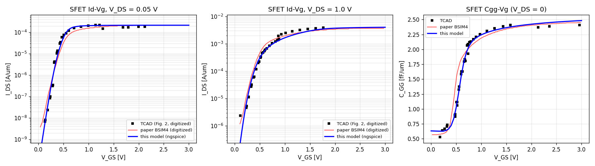
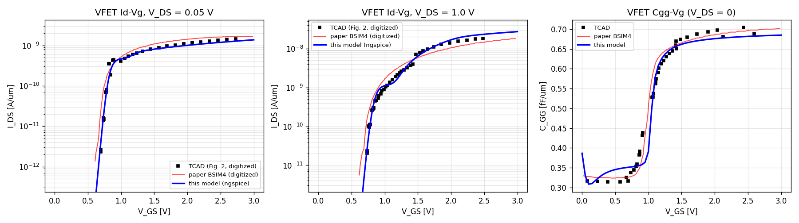
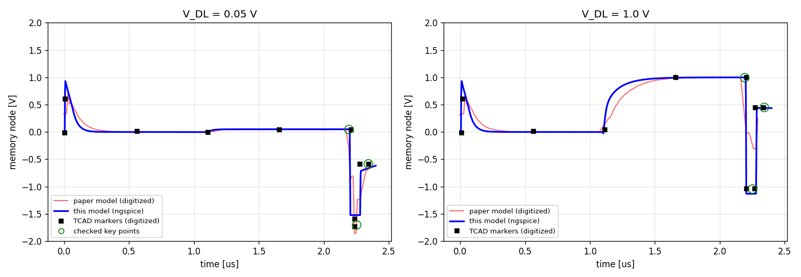
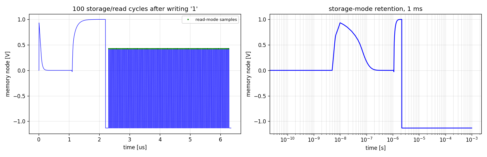
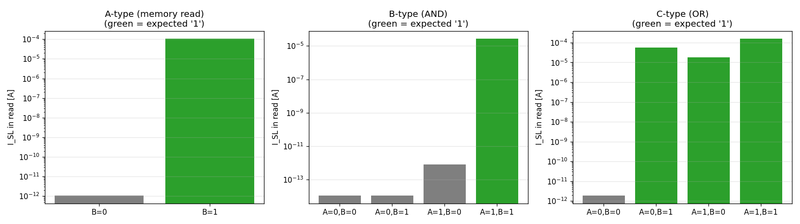

# FGFET compact-model validation

**18 / 20 checks passed.** Generated by `test/run_tests.py` (ngspice + OpenVAF OSDI).

| Test | Check | Value | Limit | Result |
|---|---|---|---|---|
| T1 | Id-Vg @Vds=0.05 V rms log10 error [dec] (paper's BSIM4: 0.355) | 0.191 | < 0.25 | PASS |
| T1 | Id-Vg @Vds=1.0 V rms log10 error [dec] (paper's BSIM4: 0.227) | 0.192 | < 0.25 | PASS |
| T1 | Cgg-Vg rms relative error [%] | 5.03 | < 5.0 | **FAIL** |
| T2 | Id-Vg @Vds=0.05 V rms log10 error [dec] (paper's BSIM4: 0.358) | 0.110 | < 0.25 | PASS |
| T2 | Id-Vg @Vds=1.0 V rms log10 error [dec] (paper's BSIM4: 0.293) | 0.094 | < 0.25 | PASS |
| T2 | Cgg-Vg rms relative error [%] | 5.76 | < 5.0 | **FAIL** |
| T3 | V_DL=0.05 V storage-mode V_MN error [V] (model -1.524, TCAD -1.70) | 0.176 | < 0.25 | PASS |
| T3 | V_DL=0.05 V read-mode V_MN error [V] (model -0.665, TCAD -0.58) | 0.085 | < 0.1 | PASS |
| T3 | V_DL=0.05 V write-mode V_MN error [V] (model +0.050, TCAD +0.05) | 0.000 | < 0.05 | PASS |
| T3 | V_DL=1.0 V storage-mode V_MN error [V] (model -1.132, TCAD -1.04) | 0.092 | < 0.25 | PASS |
| T3 | V_DL=1.0 V read-mode V_MN error [V] (model +0.438, TCAD +0.45) | 0.012 | < 0.1 | PASS |
| T3 | V_DL=1.0 V write-mode V_MN error [V] (model +1.000, TCAD +1.00) | 0.000 | < 0.05 | PASS |
| T4 | read current '1' [A/um] (V_MN = +0.438 V) | 1.498e-04 | > 1e-6 | PASS |
| T4 | read current '0' [A/um] (V_MN = -0.645 V) | 1.314e-11 | < 1e-9 | PASS |
| T4 | I('1') / I('0') | 1.140e+07 | > 1e4 | PASS |
| T5 | V_MN drift over 100 read cycles [mV] (first read +0.4292 V) | 0.782 | |x| < 5 | PASS |
| T5 | storage-mode V_MN change over 1 ms [mV] (-1.1321 -> -1.1315 V) | 0.563 | |x| < 10 | PASS |
| T6 | A-type (memory read): min I(expected 1) / max I(expected 0) | 9.672e+07 | > 100 | PASS |
| T6 | B-type (AND): min I(expected 1) / max I(expected 0) | 3.448e+07 | > 100 | PASS |
| T6 | C-type (OR): min I(expected 1) / max I(expected 0) | 9.464e+06 | > 100 | PASS |

## T6 detail: memory node and SL current 5-15 ns into the read (w_dev = 64 nm)

| Scheme | A | B | V_DL write [V] | V_WL read [V] | V_MN read [V] | I_SL [A] | expected |
|---|---|---|---|---|---|---|---|
| A-type (memory read) | - | 0 | 0.05 | 0.5 | -0.746 | 1.079e-12 | 0 |
| A-type (memory read) | - | 1 | 1.9 | 0.5 | +1.037 | 1.044e-04 | 1 |
| B-type (AND) | 0 | 0 | 0.1 | 0.0 | -0.355 | 1.090e-14 | 0 |
| B-type (AND) | 0 | 1 | 1.8 | 0.0 | +0.316 | 1.090e-14 | 0 |
| B-type (AND) | 1 | 0 | 0.1 | 1.8 | -0.089 | 7.757e-13 | 0 |
| B-type (AND) | 1 | 1 | 1.8 | 1.8 | +1.547 | 2.675e-05 | 1 |
| C-type (OR) | 0 | 0 | 0.85 | 0.0 | -0.140 | 1.881e-12 | 0 |
| C-type (OR) | 0 | 1 | 1.85 | 0.0 | +0.744 | 5.544e-05 | 1 |
| C-type (OR) | 1 | 0 | 0.85 | 1.2 | +0.517 | 1.780e-05 | 1 |
| C-type (OR) | 1 | 1 | 1.85 | 1.2 | +1.359 | 1.556e-04 | 1 |

## Plots

