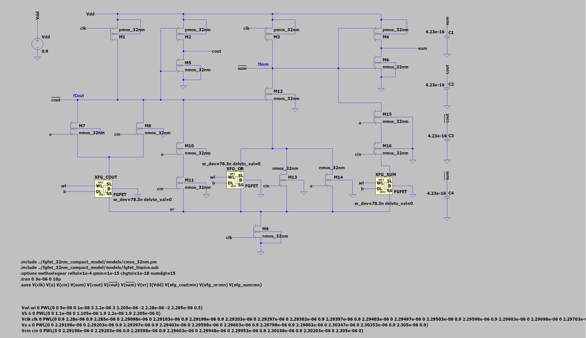
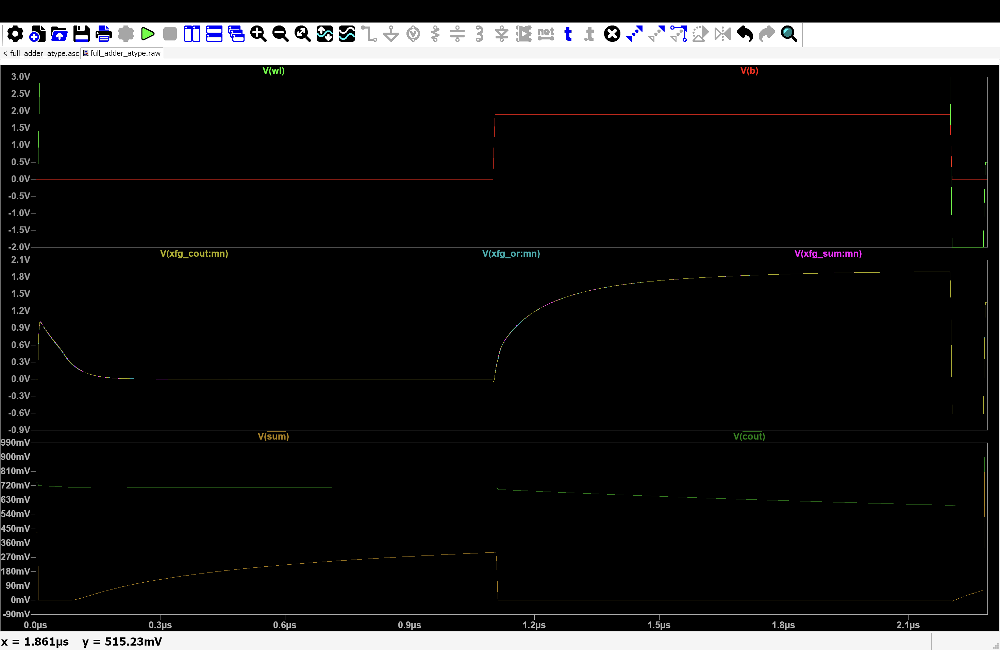
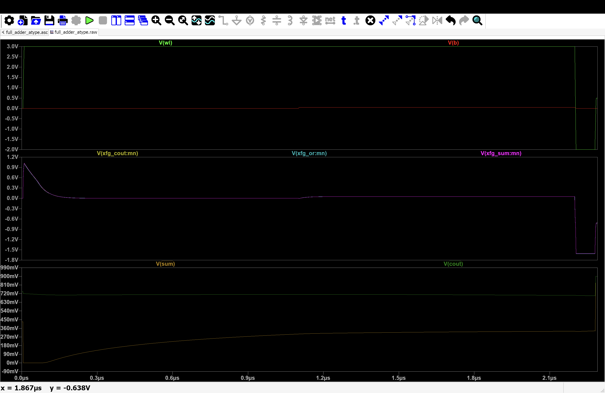
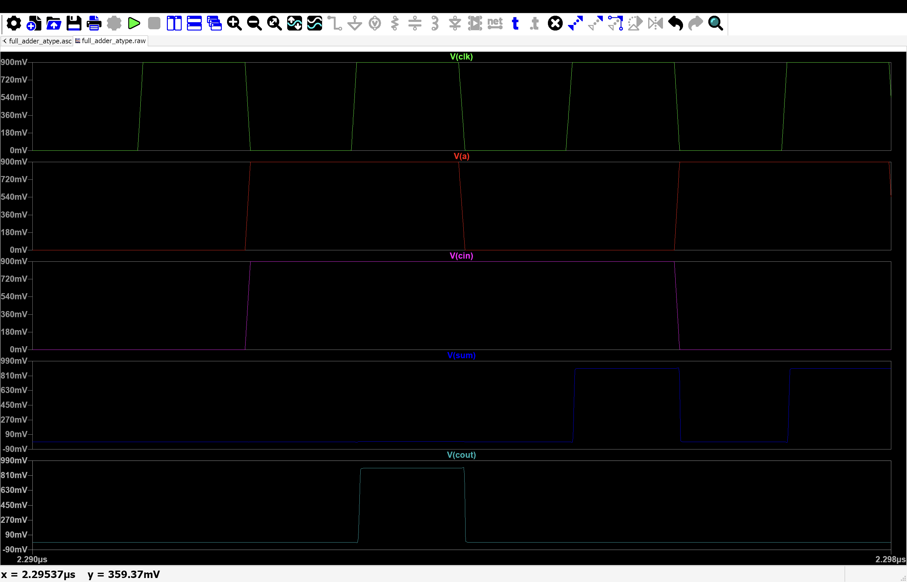
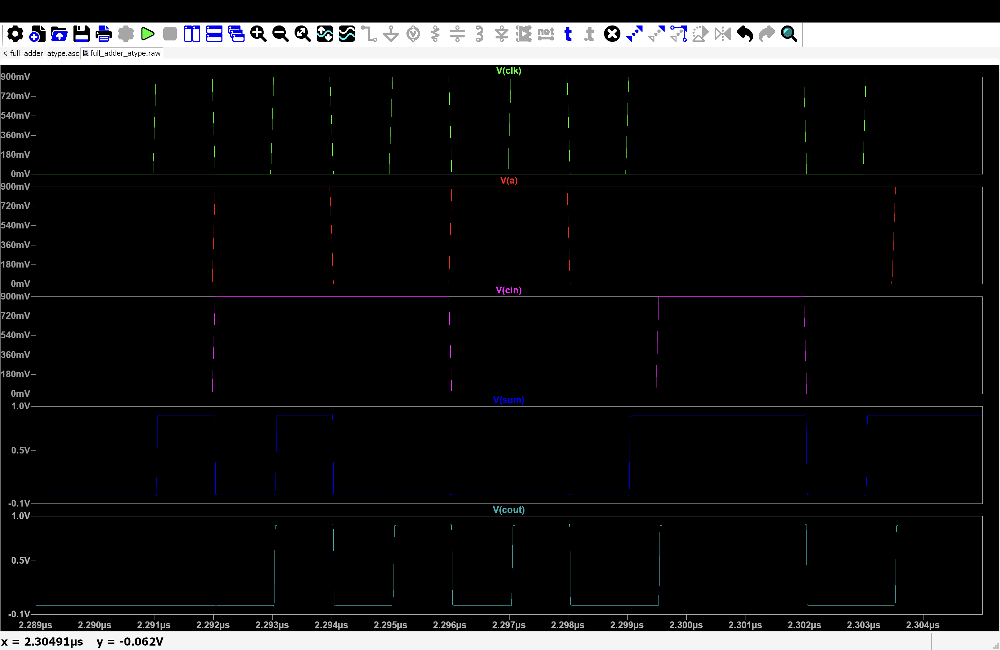

# FGFET A-type full adder: LTspice results

## Contents

1. Summary: paper vs. simulation
2. Circuit, devices and sizing
3. Simulation setup and stimuli
4. Logic function and timing waveforms
5. Methodology and definitions (delay, power, PDP)
6. Why the results deviate from the paper
7. Sensitivity to the FGFET and C_VA model parameters
8. Paper figures for the A-type circuit
9. Area: not obtained (caveat and method)
10. Recommendations
11. Running the scripts; files

Scope: the A-type logic-in-memory full adder of S. Kim et al., *IEEE Access* 2023, Fig. 6(a) (16 FET + 3 FGFET), drawn by hand in [full_adder_atype.asc](../full_adder_atype.asc). Simulator: LTspice 26.0.2 (macOS), BSIM4 level-54 cards from `fgfet_32nm_compact_model/models/` and the C_VA coupling capacitor. **Every number and every figure in this report comes from that schematic.** `results/metrics.json` and the waveform files store a SHA-256 hash of the schematic's circuit (LTspice's netlist without comments, the `.save` list and the `Vb` line, so toggling B or the saved signals in the GUI does not change it), and the plotting script stops if the stored data do not match the current schematic.

---

## 1. Summary: paper vs. simulation

| Metric (A-type) | Paper | LTspice | Deviation |
|---|---|---|---|
| Transistor count | 19 (16 FET + 3 FGFET) | 19 (16 FET + 3 FGFET) | exact |
| Reduction vs. 28-FET adder | 9 fewer | 9 fewer | exact |
| V_DD | 0.9 V | 0.9 V | exact |
| Propagation delay t_PLH, Cin → Cout (0 + 1) | 43.54 ps | **34.27 ps** | −21.3 % |
| Dynamic power P_dyn | 1.14 µW | **1.316 µW** | +15.4 % |
| Static power P_static (average) | 13.64 nW | **12.35 nW** | −9.5 % |
| PDP (P_dyn × t_p) | 49.64 aW·s | **45.09 aW·s** | −9.2 % |
| Delay vs. conventional (44.55 ps) | 97.73 % | 76.9 % | |
| Static vs. conventional (16.51 nW) | 82.62 % | 74.8 % | |
| P_dyn vs. conventional (1.14 µW) | 100 % | 115.4 % | |
| PDP vs. conventional (50.79 aW·s) | 97.73 % | 88.8 % | |
| Layout area | 2.46 µm² (−34.4 % vs. 3.75 µm²), 4 metal layers | **not obtained**, see section 9 | n/a |

The simulated numbers do not match the paper's. Transistor count, V_DD and the logic function (section 4) agree exactly. Delay is 21 % low, dynamic power 15 % high, static power 10 % low and PDP 9 % low. Section 6 lists the probable causes. The percent-of-conventional rows divide the simulated values by the paper's 28-FET figures, because the conventional adder was not simulated.

Additional metrics given by the protocol (not in the paper's table):

| Metric | Value |
|---|---|
| t_PLH, A → Cout (Cin = 0, B = 1) | 35.12 ps |
| t_PLH over all input cases, B = 0 and 1 | 33.31 to 39.60 ps (section 5.2) |
| Worst-case t_p (maximum of the two t_PLH values) | 35.12 ps |
| t_PHL | undefined (section 5.3) |
| P_avg, B = 1 / B = 0 / mean | 1.555 / 1.102 / 1.328 µW |
| P_static, maximum over the 8 combinations | 12.38 nW |
| Energy per cycle (P_dyn × 2 ns) | 2.63 fJ |
| Stored memory-node voltage at read, '1' / '0' | +1.356 V / −0.72 V |

---

## 2. Circuit, devices and sizing

**Topology** (names as in the schematic; the netlist is checked device by device against Fig. 6(a)):

| Block | Devices | Function |
|---|---|---|
| Precharge | M1 (on `_cout`), M3 (on `_sum`), PMOS, gate = CLK | precharge the dynamic nodes to V_DD while CLK = 0 |
| Output inverters | M2/M5 (`_cout` → `cout`), M4/M6 (`_sum` → `sum`) | Cout = NOT(`_cout`), Sum = NOT(`_sum`) |
| !Cout pull-down | M7 (A), M8 (Cin) in parallel in series with XFG_COUT; M10 (A) in series with M11 (Cin) | `_cout` falls when (A + Cin)·B + A·Cin |
| !Sum pull-down | M12 (gated by `_cout`) in series with the parallel group XFG_OR, M13 (Cin), M14 (A); M15 (A), M16 (Cin) in series with XFG_SUM | `_sum` falls for the odd-parity terms |
| Footer | M9, NMOS, gate = CLK, node `vr` | enables the pull-downs while CLK = 1 |
| Wire capacitors | C1 (`sum`), C2 (`cout`), C3 (`_cout`), C4 (`_sum`) | lumped layout-parasitic estimate |

Each FGFET (`XFG_COUT`, `XFG_OR`, `XFG_SUM`) is the subcircuit `fgfet_ltspice.sub`: a vertical FET (VFET) from DL to the memory node (gate WL), a sense FET (SFET) from SL to SS (gate = memory node), and the coupling capacitor C_VA between WL and the memory node. B is the bit stored in the memory node. The three FGFETs share WL and DL.

**How the FGFET is represented in LTspice (symbol, subcircuit, model cards).** Three separate files are involved:

| File | Role | Used when |
|---|---|---|
| `FGFET.asy` | the schematic symbol: the drawing, the five pins (WL, DL, SL, SS, B), the instance prefix `X` and the name `FGFET`. It contains no electrical model. LTspice lists it in the *Component* dialog (P) because it sits in the schematic's folder, so it must be copied together with the `.asc` file. | placing the device and building the netlist |
| `fgfet_ltspice.sub` | the subcircuit `FGFET`: `M_VFET` (model `vfet_nmos`), `M_SFET` (model `sfet_nmos`), the coupling capacitor `C_CVA` and the DC path `R_conv`. It is pulled in by the `.include` line in the schematic; without that line LTspice reports "This sub-circuit name is not defined". | running the simulation |
| `sfet_32nm.pm`, `vfet_32nm.pm` | the BSIM4 cards of the SFET and the VFET, included by `fgfet_ltspice.sub` | running the simulation |

The 16 baseline transistors do not use these files. M1–M16 use the cards `nmos_32nm` and `pmos_32nm` from `cmos_32nm.pm` (the NMOS card is the SFET fit with the PTM GIDL kept). The static-power runs (section 5.5) use `sfet_nmos` directly.

**Sizing.** The paper gives no device widths and no parasitics. The widths below were chosen earlier by a least-squares fit inside practical rules fixed beforehand: every width between 64 nm (2 × L) and 400 nm; inverter PMOS at most 2 × its NMOS; footer no narrower than the logic stacks; node capacitance at most 0.5 fF; and a weak preference for small devices. They are used unchanged here.

| Parameter | Value in the schematic |
|---|---|
| Inverter NMOS (M5, M6) / PMOS (M2, M4) | 195 nm / 342 nm (P:N = 1.75) |
| Precharge PMOS (M1, M3) | 84.4 nm |
| Logic NMOS (M7, M8, M10–M16) and footer (M9) | 64 nm (the lower bound) |
| FGFET (XFG_*) | 78.3 nm |
| Wire capacitors C1–C4 | 0.423 fF each |
| Channel length of all baseline FETs | 32 nm |

The logic stacks and footer sit on the 64 nm bound and the node capacitance sits near its 0.5 fF limit, so the fit is limited by the practical rules, and the deviations in section 1 are what remains. Widening the rules would shrink them, but only by allowing impractical devices.



*The A-type full adder as drawn in LTspice (`full_adder_atype.asc`), including the model includes, solver options, `.save` list and the source definitions.*

---

## 3. Simulation setup and stimuli

**Supply.** V_DD is a static 0.9 V DC source (`Vdd`) for the whole run. The inputs `clk`, `a`, `cin`, `wl` and `b` are transient (piecewise-linear) sources.

**Solver settings** (from the schematic): `.options method=gear reltol=1e-4 gmin=1e-15 chgtol=1e-18 numdgt=15`, `.tran 0 3e-06 0 10p` (3 µs, maximum step 10 ps), temperature 27 °C. The small `gmin` and `chgtol` are needed because the memory node is floating (model README, "Simulator settings").

**FGFET programming** (paper Sec. III-B, Table II), applied through `Vwl` and `Vb` before the logic phase:

| Phase | Time | WL | DL (`b`) |
|---|---|---|---|
| Initialize | from 10 ns | 3 V | 0 V |
| Write | 1.105 µs to 2.2 µs | 3 V | 1.9 V for '1', 0.05 V for '0' |
| Storage | 2.205 µs to 2.28 µs | −2 V | 0 V |
| Read | from 2.285 µs | 0.5 V | 0 V |

The write needs about 1 µs because the memory node charges slowly. B = 1 uses the 1.9 V write level and B = 0 uses 0.05 V; this is the only difference between the two runs.

**CLK during programming.** The dynamic nodes must not be precharged during the write. In this adder SL is the precharged node, and Table II requires SL = 0 V until the read. CLK is therefore held high (precharge PMOS off, footer on) through initialize, write and storage, and falls at the read edge (2.285 µs). The paper does not state this sequencing. With CLK held low instead, the nodes charge to 0.9 V during the write, the stored '1' reads only 0.67 V, and Sum is wrong in two of the four windows.

**Logic phase.** The window used for Fig. 6 starts at **2.29 µs**, 5 ns after WL reaches the read voltage, so the memory node has settled after the read edge, and lasts **8 ns**, as in the paper's Fig. 6(b), (c). The clock has a 2 ns period (1 ns precharge, 1 ns evaluate), 50 ps edges, and A and Cin change while CLK is low:

| Window after 2.29 µs | CLK | (A, Cin) |
|---|---|---|
| 0–1 ns | low (precharge) | (0, 0) |
| 1–2 ns | high (evaluate) | (0, 0) |
| 3–4 ns | high | (1, 1) |
| 5–6 ns | high | (0, 1) |
| 7–8 ns | high | (1, 0) |

After the Fig. 6 window the stimulus continues with CLK held high for two data-to-output delay tests (B = 1 stored): Cin 0 → 1 at 2.2995 µs with A = 0, and A 0 → 1 at 2.3035 µs with Cin = 0. The sources end at 2.305 µs and the run continues to 3 µs with CLK, A and Cin held at their last values; this tail is not used by any metric. They provide the propagation-delay measurement (section 5.2) because, with CLK already high, the output responds to the data input and not to a clock edge. The stored memory-node voltage at read is +1.356 V for '1' and −0.72 V for '0'.

Programming sequence as plotted in the LTspice waveform viewer from `full_adder_atype.asc` (0 to 2.29 µs). Top pane: word line `V(wl)` and data line `V(b)`. Middle pane: the memory nodes of the three FGFETs, which overlap. Bottom pane: the dynamic nodes `_cout` and `_sum` (shown with an overbar in LTspice).

**B = 1 stored** (write level 1.9 V):



**B = 0 stored** (write level 0.05 V):



Reading the plots:

- **Initialize (WL = 3 V from about 10 ns).** The memory nodes show a short spike to about 1 V and decay to 0 V.
- **Write (from 1.1 µs).** For B = 1 the memory nodes charge slowly towards about 1.88 V; for B = 0 they stay near 0 V with a small step to the 0.05 V write level.
- **Storage (WL = −2 V from 2.205 µs).** The memory nodes are pulled down by the coupling capacitor, to about −0.61 V for B = 1 and about −1.6 V for B = 0.
- **Read (WL = 0.5 V at 2.285 µs).** The nodes rise to about +1.36 V for B = 1 and about −0.72 V for B = 0 once the dynamic nodes are precharged.
- **Dynamic nodes.** `_cout` stays near 0.6 to 0.7 V and `_sum` near 0 to 0.3 V while CLK is held high; both are precharged to V_DD when CLK falls at the read edge.

---

## 4. Logic function and timing waveforms

Logic waveforms plotted in the LTspice waveform viewer from `full_adder_atype.asc` (rows: CLK, A, Cin, Sum, Cout). They correspond to the timing graphs of the paper's Fig. 6(c) (B = 0) and Fig. 6(b) (B = 1). The window starts at 2.29 µs.

**B = 0 stored** (window 2.29 µs to 2.298 µs):



**B = 1 stored** (axis 2.289 µs to 2.305 µs, so it also shows the two delay-test edges after 2.298 µs):



All four evaluate windows give the expected Sum and Cout. Voltages are sampled 0.95 ns into each window; high is at least 0.9 × V_DD (measured 0.9 V), low is at most 0.1 × V_DD (measured below 3.5 mV):

| Window (ns) | A | Cin | B = 1: Sum / Cout | B = 0: Sum / Cout |
|---|---|---|---|---|
| 1–2 | 0 | 0 | 1 / 0 | 0 / 0 |
| 3–4 | 1 | 1 | 1 / 1 | 0 / 1 |
| 5–6 | 0 | 1 | 0 / 1 | 1 / 0 |
| 7–8 | 1 | 0 | 0 / 1 | 1 / 0 |

Together with the second value of B, this covers all eight (A, B, Cin) combinations.

---

## 5. Methodology and definitions

### 5.1 What the paper states and what is assumed

The paper states the circuit, the case used for the delay (below), and that PDP is the product of delay and dynamic power. It does not state the measurement thresholds, the averaging window, the input states, how static and dynamic power were separated, or which supplies were counted. Where the paper is silent, the **typical SPICE definition** is used and marked as such.

### 5.2 Propagation delay t_PLH

- **Paper:** "1-bit delay", the time for Cout to be calculated after Cin is entered when '0'+'1' is calculated (Sec. III-A, applied to the A-type in Sec. III-B). No threshold or edge is given.
- **Definition used (typical):** the time from the 50 % point (0.45 V) of the rising Cin to the 50 % point of the rising Cout,

  t_PLH = t[Cout = 0.45 V, rising] − t[Cin = 0.45 V, rising].

- **Conditions:** B = 1 stored, A = 0, Cin 0 → 1, CLK already high (evaluate phase), so the output responds to the data input and not to the clock.
- **Extraction:** linear interpolation between simulation samples around the 0.45 V crossings, starting the search 0.2 ns before the nominal input edge.
- **Result:** Cin crosses 0.45 V at 2.299505 µs and Cout at 2.299539 µs, so t_PLH = **34.27 ps**.
- **Extra:** the same measurement from A (Cin = 0, B = 1, A 0 → 1 at 2.3035 µs) gives 35.12 ps.

**All input cases.** B is a stored bit, so the data inputs that can start a transition are Cin and A. For each stored bit (B = 0, 1), each step input (Cin or A, rising 0 → 1 with CLK already high) and each value of the other input (0 or 1), a separate run measures t_PLH when Cout makes a 0 → 1 transition (`delay_cases` in `metrics.json`). In these runs CLK rises 0.55 ns before the data edge (0.48 ns in the Fig. 6 stimulus), which explains the 0.4 ps difference in the case that appears in both (33.90 ps against 34.27 ps).

| Stored B | Step input | Other input | Cout before → after | t_PLH |
|---|---|---|---|---|
| 0 | Cin 0 → 1 | A = 0 | 0 → 0 | no transition (Cout = 0) |
| 0 | Cin 0 → 1 | A = 1 | 0 → 1 | 39.60 ps |
| 0 | A 0 → 1 | Cin = 0 | 0 → 0 | no transition (Cout = 0) |
| 0 | A 0 → 1 | Cin = 1 | 0 → 1 | 38.00 ps |
| 1 | Cin 0 → 1 | A = 0 | 0 → 1 | 33.90 ps (the paper's '0'+'1' case) |
| 1 | Cin 0 → 1 | A = 1 | 1 → 1 | no transition (Cout already 1) |
| 1 | A 0 → 1 | Cin = 0 | 0 → 1 | 33.31 ps |
| 1 | A 0 → 1 | Cin = 1 | 1 → 1 | no transition (Cout already 1) |

In every case the final Cout equals the majority of (A, B, Cin). Where Cout does not change there is no delay to measure, so those cases are reported as such and not as zero. The worst case over all rising cases is 39.60 ps (B = 0, Cin step with A = 1).

### 5.3 t_PHL

Not defined for this circuit and not given in the paper. The adder is dynamic logic: once a pull-down discharges `_cout`, a falling data input cannot make Cout fall; Cout returns low only when CLK precharges `_cout`. There is therefore no data-to-output high-to-low delay and no rise/fall average. The worst-case delay is the larger of the two t_PLH values (35.12 ps).

### 5.4 Average power P_avg

- **Definition (typical):** the average power drawn from the logic supply over the 8 ns Fig. 6 window,

  P_avg = (V_DD / T) · ∫ (−I(V_DD)) dt, with T = 8 ns, from 2.29 µs to 2.298 µs.

- **Extraction:** trapezoidal integration of the saved supply-current samples (`I(Vdd)`). The sign is negative because the source delivers current.
- **Coverage:** one run with B = 1 and one with B = 0. Together the two runs cover all eight (A, B, Cin) combinations, and the two P_avg values are averaged: 1.555 µW (B = 1) and 1.102 µW (B = 0), mean **1.328 µW**.
- **Per input combination:** the same integral taken over one clock period (precharge plus evaluate) for each combination gives the table below. The mean of the four values reproduces the B-run P_avg (1.552 µW for B = 1, 1.100 µW for B = 0, against 1.555 and 1.102 µW over the 8 ns window; the small difference is the window boundary).

  | (A, Cin) | Clock period | P_avg, B = 1 | P_avg, B = 0 |
  |---|---|---|---|
  | (0, 0) | 0–2 ns | 0.454 µW | −0.024 µW |
  | (1, 1) | 2–4 ns | 1.853 µW | 1.842 µW |
  | (0, 1) | 4–6 ns | 2.116 µW | 1.388 µW |
  | (1, 0) | 6–8 ns | 1.785 µW | 1.193 µW |

  The (0, 0) period follows the read edge and starts from the already precharged state, so little charge is drawn; the slightly negative B = 0 value is net charge returned to the supply through the coupling in that period. Each value is a single period and depends on the previous state.
- **Supplies counted:** only the logic V_DD. The WL and DL programming drivers are simulated, but their energy is not counted as computation power.

### 5.5 Static power P_static

- **Paper:** gives the value only (13.64 nW); no method.
- **Definition (typical leakage definition):** the DC supply power with the clock low and no switching.
- **Extraction:** a DC operating-point sweep over all eight combinations of (CLK, A, Cin) per stored bit, with the memory node of each FGFET pinned at the voltage measured at the start of the logic window (+1.356 V for B = 1, −0.72 V for B = 0). Each FGFET is replaced by its sense FET with the memory node tied to that voltage (same W and L). The netlist is derived from the schematic's own netlist, so the sizing is identical.
- **Which states count:** CLK = 0 (precharge/standby), over (A, Cin) = 00, 01, 10, 11 and B = 0, 1, so 8 combinations. The average (**12.35 nW**) and the maximum (12.38 nW) are reported:

  | (A, Cin) | P_static, B = 1 | P_static, B = 0 |
  |---|---|---|
  | (0, 0) | 12.358 nW | 12.245 nW |
  | (0, 1) | 12.367 nW | 12.347 nW |
  | (1, 0) | 12.367 nW | 12.347 nW |
  | (1, 1) | 12.376 nW | 12.358 nW |
- **Why CLK = 1 is excluded:** at CLK = 1 the dynamic nodes float, so the DC operating point lands mid-rail and carries 14–16 µW of crowbar current in the evaluate states. That is not leakage.

### 5.6 Dynamic power P_dyn

- **Paper:** gives the value only (1.14 µW). It states that the A-type figure includes leakage current while the transistor connected to `!Cout` is not immediately turned off, which means short-circuit current is part of it.
- **Definition (typical):** the average power minus the static power,

  P_dyn = P_avg − P_static = 1.328 µW − 0.0123 µW = **1.316 µW**.

  Short-circuit current is left in, in line with the paper's remark.

### 5.7 PDP and energy per cycle

- **PDP (stated in the paper):** the product of delay and dynamic power. PDP = P_dyn × t_PLH = 1.316 µW × 34.27 ps = **45.09 aW·s**.
- **Energy per cycle (extra):** P_dyn × the 2 ns clock period = 2.63 fJ.

### 5.8 Other fixed conditions

Input and clock edge time is 50 ps (read off the paper's timing graphs), the clock period is 2 ns, and no output load is applied beyond the wire capacitors C1–C4.

### 5.9 Data flow

1. `scripts/fa.py` takes LTspice's own netlist of `full_adder_atype.asc` (the authoritative circuit description) and checks that the stimulus matches the windows above.
2. It runs LTspice on temporary copies of the schematic: B = 1 as drawn, and B = 0 with only the `Vb` write level changed; `V(wl) V(b)` are added to the `.save` list for plotting.
3. `scripts/metrics.py` extracts delay, P_avg and the logic check from the raw data.
4. The static DC runs use the netlist derived in step 1 (section 5.5). The delay sweep (section 5.2, 8 runs) uses further temporary copies in which only the Cin/A/CLK sources are replaced by the test stimulus.
5. `scripts/run_all.py` writes `results/metrics.json` and the waveform files, with the hash of the schematic's circuit; `scripts/make_plots.py` draws the Python figures from them.

---

## 6. Why the results deviate from the paper

The deviations are: delay 21 % low (the circuit is faster), dynamic power 15 % high, static power 10 % low, PDP 9 % low. The causes below are split by what was tested and what could not be.

**Tested**

- **The FGFET device model is not the cause.** Perturbing every SFET, VFET and C_VA parameter (section 7) moves the delay by at most 0.2 ps for ordinary changes. Extreme changes reach 3.5 ps with the logic intact (and 8.4 ps only once the logic fails), and they raise dynamic power by 7 % to 100 % or more. Static power does not move, because at CLK = 0 the leakage is through the CMOS devices.
- **The sizing is limited by the practical rules, not by the fit.** The logic stacks and footer are on the 64 nm lower bound and the node capacitance is near its 0.5 fF limit (section 2). Delay and dynamic power both rise with load, so closing one gap opens the other.
- **The 28-FET adder was not simulated.** The percent-of-conventional rows inherit every deviation above.

**Not specified in the paper (the values used are assumptions)**

- **Transistor widths, including the PMOS.** The paper gives no W/L for any device. Delay and power scale with width and load, so this is the largest lever.
- **Wire and contact parasitics and the output load.** A lumped 0.423 fF per node is used. The paper's four-metal-layer layout (Fig. 9(b)) has its own parasitics.
- **Measurement definitions.** The threshold, the window, the input states for the power numbers, the split between static and dynamic power and the supplies counted are not stated (section 5). A different choice shifts P_dyn and P_static directly.
- **Input slew, clock period and edge alignment.** 50 ps edges and a 2 ns period are used, with inputs changing on the falling CLK edge. These change delay and the short-circuit part of dynamic power.
- **Programming and CLK sequencing in the adder.** The memory node reads +1.36 V (B = 1) when the dynamic nodes are precharged and about +1.0 V when they are evaluated. That level sets the SFET drive, and the paper does not state the sequencing.
- **Simulator, temperature and corner.** LTspice's BSIM4 at 27 °C is used. The paper's simulator is not stated. C_VA is ported from Verilog-A to a charge-defined capacitor; it matches ngspice + OSDI to under 1 mV on the Fig. 4 transient.
- **Device-model fidelity.** The BSIM4 cards were reconstructed from Fig. 2 and carry about 0.19 decade RMS Id–Vg error, so absolute current levels may differ from the paper's.

These are the plausible reasons. The paper gives too little information to tell which one dominates.

**What the paper does not state (pp. 2–6):** device widths and W/L for every transistor (conventional and A-type), PMOS sizing, wire and contact parasitics, output load, input slew and clock frequency, the delay threshold and edge, how dynamic and static power were extracted (window, supplies counted, input states), the model cards and PMOS model, temperature and corner, and the programming durations in the adder.

---

## 7. Sensitivity to the FGFET and C_VA model parameters

With the circuit and sizing fixed, each model parameter was perturbed in a temporary copy of the model files (`scripts/fit_models.py probe`; data in `model_sensitivity.json`). The model files in the repository were not changed.

| Change | Delay (paper 43.54 ps) | P_dyn (paper 1.14 µW) | P_static (paper 13.64 nW) |
|---|---|---|---|
| none | 34.27 ps | 1.316 µW | 12.35 nW |
| SFET u0 ×1.25 / vsat ×1.25 | 34.21 / 34.23 | 1.315 | 12.35 |
| SFET Vth0 +0.05 V | 34.38 | 1.319 | 12.35 |
| VFET u0 ×1.25, Vth0 +0.05 V | 34.27 | 1.316 | 12.35 |
| C_VA Cmax ×1.25 / Cmin ×1.25 | 34.27 / 34.43 | 1.316 / 1.324 | 12.35 |
| SFET u0 ×0.1 (ten times weaker) | 36.71 | 1.409 | 12.35 |
| SFET Vth0 +0.3 V | 37.76 | 2.794 | 12.34 |
| SFET Vth0 +0.3 V and u0 ×0.3 | 42.67, logic fails | 3.035 | 12.34 |

The delay is set by the 64 nm logic stack and footer in series with the FGFET, not by the FGFET. Static power does not move: at CLK = 0 the leakage is through the CMOS devices (footer, stack, precharge PMOS), which are not in the FGFET models. Even extreme, unphysical FGFET changes move the delay by only a few ps, raise P_dyn and eventually break the logic. Matching the paper's three numbers together would need a change to the CMOS cards or to the sizing.

**LTspice port.** Verilog-A/OSDI is unavailable in LTspice, so [fgfet_ltspice.sub](../../fgfet_32nm_compact_model/models/fgfet_ltspice.sub) writes C_VA as a charge-defined capacitor (`Q=`) using the same closed form. Against ngspice + OSDI on the Fig. 4 transient, the memory node agrees to under 1 mV, and the BSIM4 currents agree to about 5 digits. Compact-model caveats from the [model README](../../fgfet_32nm_compact_model/README.md) carry over: the memory node bleeds within about 100 ns at WL ≥ 1.2 V, so the read window is kept short.

---

## 8. Paper figures for the A-type circuit

| Paper figure | What it shows | Counterpart here |
|---|---|---|
| Fig. 6(a) | A-type circuit (16 FET + 3 FGFET) | `full_adder_atype.asc`; screenshot `ltspice_schematic.png` |
| Fig. 6(b) | Timing graph, B = 1 stored: CLK, A, Cin, Sum, Cout over 0–8 ns | `ltspice_fig6_B1.png` (LTspice) |
| Fig. 6(c) | Timing graph, B = 0 stored | `ltspice_fig6_B0.png` (LTspice) |
| Fig. 9(b) | A-type layout, 2.46 µm², 4 metal layers | not covered (section 9) |
| Table III, A-type row | count, V_DD, delay, P_dyn, P_static, PDP, area | section 1 |

Device-level figures that the A-type relies on but that are not specific to it: Fig. 1(c) (FGFET equivalent circuit, the `FGFET` subcircuit), Fig. 2 (SFET and VFET Id–Vg and C–V, which the BSIM4 cards are fitted to), Fig. 3 (TCAD space charge, outside the scope of this circuit-level study), Fig. 4 (stand-alone FGFET transient with V_DL = 0.05 V and 1 V) and Table II (voltage conditions). `ltspice_programming_B1.png` and `ltspice_programming_B0.png` show the adder's own programming (V_DL = 1.9 V for '1'), so it is not the same as Fig. 4. Fig. 5 is the conventional 28-FET adder, not the A-type.

---

## 9. Area: not obtained (caveat and method)

**No reliable area is given in this report.** Area needs a physical layout. The paper obtains its numbers from hand layouts at ITRS 32 nm rules (Fig. 9, drawn in Cadence Virtuoso): 3.75 µm² for the conventional 28-FET adder (two metal layers) and 2.46 µm² for the A-type (four metal layers, −34.4 %). These cannot be derived from a SPICE netlist.

**Placeholder method (`scripts/area.py`), not a result.** The paper's conventional-adder area is scaled by device count, counting each FGFET (a VFET stacked on its SFET) as one device footprint:

- area per device = 3.75 µm² / 28 = 0.134 µm²
- estimate = 0.134 µm² × (16 FETs + 3 FGFETs) = 2.54 µm² (−32.1 % against 3.75 µm²), against the paper's 2.46 µm² (+3.4 %)

**Why the method is not sound.** It ignores transistor widths, routing and the extra metal layers, and counting an FGFET as one device is an assumption. Applied to the paper's own B-type (20 devices, 2.68 µm² against 2.24 µm²) and C-type (21 devices, 2.81 µm² against 2.53 µm²) it overshoots by 20 % and 11 %. The device count comes from the schematic's netlist. The figure should not be quoted as a layout result.

---

## 10. Recommendations

Options for obtaining a layout-based area and more realistic parasitics:

1. **Draw the layout in Magic VLSI.** Lay out the A-type circuit and the conventional 28-FET adder under the same design rules and compare the ratio of the two areas with the paper's −34.4 %. Magic does not ship the ITRS 32 nm rules used in the paper, so only the ratio, not the absolute µm², is comparable. The FGFET (a VFET stacked on an SFET) is not a standard cell and needs a drawing convention.
2. **Draw the layout in Electric VLSI.** Same procedure and the same caveat on the design rules. Electric offers a technology editor in which the FGFET footprint can be defined.
3. **Extract parasitics from the layout.** Replace the lumped 0.423 fF wire capacitors C1–C4 with values extracted from the drawn layout, then re-run the simulation. This removes one of the largest assumptions in section 6.
4. **Simulate the conventional 28-FET adder with the same protocol.** The percent-of-conventional rows would then compare like with like instead of dividing by the paper's figures.

Cadence Virtuoso, which the paper used for its layouts, is not available here.

---

## 11. Running the scripts; files

```bash
# run from fgfet_atype_fa_ltspice/
python3 scripts/run_all.py            # LTspice runs on full_adder_atype.asc, writes results/metrics.json and wave_B*.npz
python3 scripts/make_plots.py         # Python figures from those waveforms (stops if they are not from the current schematic)
python3 scripts/fit_models.py probe   # sensitivity to the FGFET / C_VA model parameters (section 7)
python3 scripts/area.py               # device count and the placeholder estimate (section 9)
```

Requirements: numpy and matplotlib. Every script takes its circuit from `full_adder_atype.asc` through `scripts/fa.py`; no script defines a circuit of its own. LTspice runs through the Wine binary bundled in `LTspice.app`. Setting the environment variable `FA_WINEPREFIX` to a private copy of the LTspice bottle keeps batch runs from sharing a Wine server with the LTspice GUI. When editing the schematic, capacitor values must be written in scientific notation, because LTspice reads `21.7a` as 21.7 F, not atto.

| Path | Content |
|---|---|
| `full_adder_atype.asc`, `FGFET.asy` | the schematic and its custom FGFET symbol |
| `scripts/` | `fa.py` (circuit access, runs), `metrics.py`, `run_all.py`, `make_plots.py`, `fit_models.py`, `area.py`, `ltraw.py` |
| `results/ATYPE_RESULTS.md` | this report |
| `results/ltspice_fig6_B0.png`, `ltspice_fig6_B1.png` | Fig. 6 as plotted in the LTspice waveform viewer |
| `results/ltspice_schematic.png` | screenshot of the schematic in LTspice |
| `results/ltspice_programming_B1.png`, `ltspice_programming_B0.png` | programming sequence as plotted in the LTspice waveform viewer |
| `results/fig6_replica.png`, `programming_sequence.png`, `schematic_full_adder_atype.png` | Python plots of the logic waveforms and programming sequence, and a schematic rendering (kept for reference, not used in this report) |
| `results/metrics.json`, `wave_B0.npz`, `wave_B1.npz`, `model_sensitivity.json`, `area.json` | numerical results; waveforms (programming phase thinned to every 100th sample, full resolution from the read edge to 2.31 µs) |
