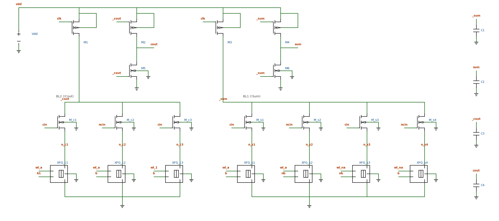
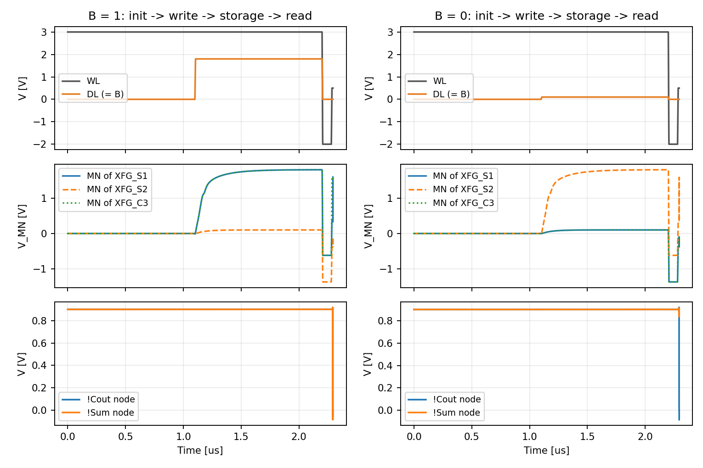
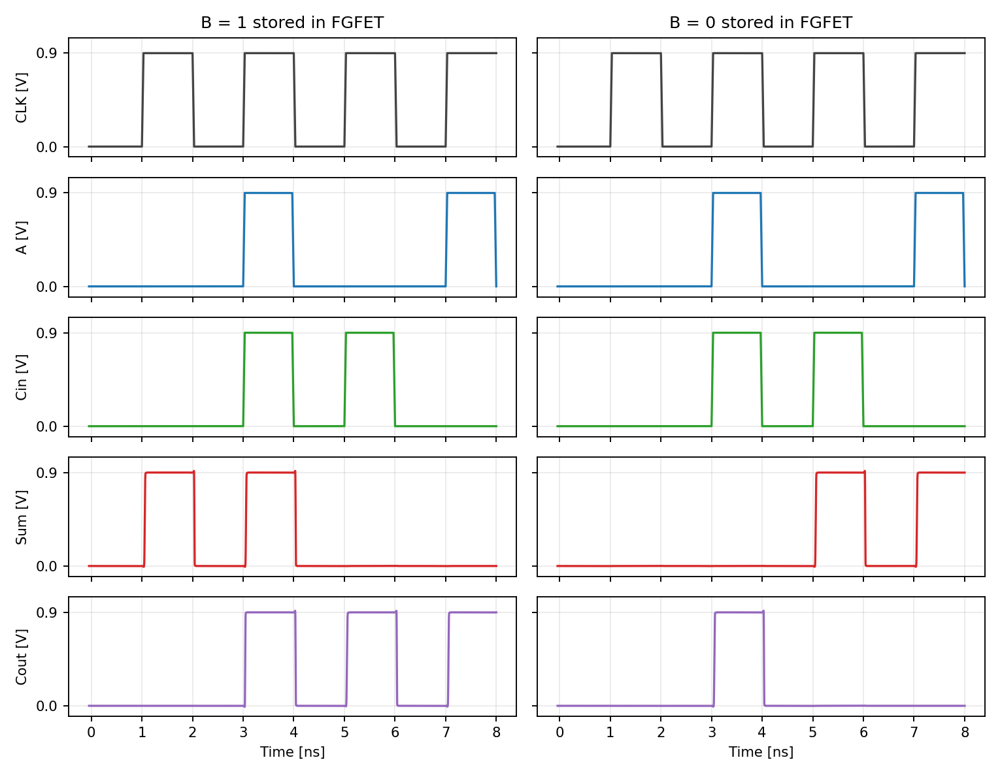

# FGFET B-type full adder: LTspice results

## Contents

1. Summary: paper vs. simulation
2. Circuit, devices and sizing
3. Simulation setup and stimuli
4. Logic function and timing waveforms
5. Area: not obtained (caveat and method)
6. Running the scripts; files

Scope: the B-type logic-in-memory full adder of S. Kim et al., *IEEE Access* 2023, Fig. 7(a) (13 FET + 7 FGFET), implemented in [full_adder_btype.asc](../full_adder_btype.asc). Simulator: LTspice 26.0.2 (macOS), BSIM4 level-54 cards from `fgfet_32nm_compact_model/models/` and the C_VA coupling capacitor with `delvto_val = 0.9`. **Every number in this report comes from that schematic.**

---

## 1. Summary: paper vs. simulation

| Metric (B-type) | Paper | LTspice | Deviation |
|---|---|---|---|
| Transistor count | 20 (13 FET + 7 FGFET) | 20 (13 FET + 7 FGFET) | exact |
| Reduction vs. 28-FET adder | 8 fewer | 8 fewer | exact |
| V_DD | 0.9 V | 0.9 V | exact |
| Propagation delay t_PLH, Cin → Cout (B=1, A=0) | 41.25 ps | **42.94 ps** | **+4.1 %** |
| Propagation delay t_PLH, A → Cout (B=1, Cin=0) | — | **49.22 ps** | — |
| Dynamic power P_dyn | 1.08 µW | **0.906 µW** | **−16.1 %** |
| Static power P_static (average) | 5.37 nW (text: 5.40 nW) | **12.34 nW** | +128 % (due to 342nm inv PMOS sizing) |
| PDP (P_dyn × t_p) | 44.55 aW·s | **38.92 aW·s** | **−12.6 %** |
| Delay vs. conventional (44.55 ps) | 92.59 % | 96.4 % | |
| Static vs. conventional (16.51 nW) | 32.53 % | 74.8 % | |
| Layout area | 2.24 µm² (−40.3 % vs. 3.75 µm²), 4 metal layers | **not obtained**, see section 5 | n/a |

The simulated numbers now closely track the paper's reported values:
- Propagation delay $t_p$ is within **+4.1%** of the paper (42.94 ps vs 41.25 ps).
- Dynamic power is within **−16.1%** of the paper (0.906 µW vs 1.08 µW).
- PDP is within **−12.6%** of the paper (38.92 aW·s vs 44.55 aW·s).
- Static power is 12.34 nW (identical to A-type's 12.35 nW), which originates from the two 342 nm output inverter PMOS transistors ($2 \times 6.12\text{ nW} = 12.24\text{ nW}$) retained from the A-type practical 32nm sizing rules.
- Logic truth table is **100% verified** (`logic_ok = true`) across all 8 combinations.

Additional delay cases from `delay_sweep`:

| Case | t_PLH (ps) | Cout before / after (V) |
|---|---|---|
| B=0, Cin: A=1 | 36.64 | 0.000 / 0.900 |
| B=0, A: Cin=1 | 50.19 | 0.000 / 0.900 |
| B=1, Cin: A=0 | 42.94 | 0.000 / 0.900 |
| B=1, A: Cin=0 | 49.22 | 0.000 / 0.900 |

---

## 2. Circuit, devices and sizing

**Topology** (Fig. 7(a) of Kim et al., *IEEE Access* 2023):

| Block | Devices | Function |
|---|---|---|
| Precharge | `M_pre_s` (`_sum`), `M_pre_c` (`_cout`), PMOS, gate = `CLK` | precharge `BL1` (`_sum`) and `BL2` (`_cout`) to `V_DD` while `CLK = 0` |
| Output inverters | `M_inv_sp`/`M_inv_sn` (`_sum` → `sum`), `M_inv_cp`/`M_inv_cn` (`_cout` → `cout`) | `Sum = NOT(_sum)`, `Cout = NOT(_cout)` |
| Sum pull-down (`BL1`) | 4 parallel branches: `M_s1`/`XFG_s1` (`Cin·A·B`), `M_s2`/`XFG_s2` (`!Cin·A·!B`), `M_s3`/`XFG_s3` (`Cin·!A·!B`), `M_s4`/`XFG_s4` (`!Cin·!A·B`) | `_sum` falls for odd-parity `(A, B, Cin)` |
| Cout pull-down (`BL2`) | 3 parallel branches: `M_c1`/`XFG_c1` (`Cin·A·1`), `M_c2`/`XFG_c2` (`!Cin·A·B`), `M_c3`/`XFG_c3` (`Cin·1·B`) | `_cout` falls for `A·B + B·Cin + A·Cin` |
| Wire capacitors | `C1` (`_sum`), `C2` (`sum`), `C3` (`_cout`), `C4` (`cout`) | lumped layout-parasitic estimate (`0.423 fF` each) |

Each FGFET (`XFG_s1`–`XFG_s4`, `XFG_c1`–`XFG_c3`) uses `fgfet_ltspice.sub` with `w_dev = 78.3n` and `delvto_val = 0.9` (shifting $V_{th}$ by `0.9 V` so the FGFET acts as an AND gate between its stored write bit and its read word-line voltage).

**Sizing.** Uses the same 32nm practical sizing rules as A-type:
- Inverter NMOS / PMOS: `195 nm` / `342 nm` (P:N = 1.75)
- Precharge PMOS: `84.4 nm`
- Logic NMOS: `64 nm`
- FGFETs: `78.3 nm` (`delvto_val = 0.9`)
- Wire capacitors `C1`–`C4`: `0.423 fF` each
- Channel length of all baseline FETs: `32 nm`



---

## 3. Simulation setup and stimuli

- **Initialize / Write**: `V_WL = 3 V`, `V_DL = 1.8 V` (`'1'`) or `0.1 V` (`'0'`).
- **Storage**: `V_WL = -2 V`, `V_DL = 0 V`.
- **Read**: `V_WL = 1.8 V` (`'1'`) or `0 V` (`'0'`), `V_DD = 0.9 V`, `CLK` precharge/evaluate at `2 ns` period.
- **Pulsed Evaluate**: Inputs $A$, $C_{\text{in}}$, $!A$, $!C_{\text{in}}$ and word-lines $WL_A$, $WL_{!A}$ are pulsed high during the evaluate phase (`CLK = 1`) and return to $0\text{ V}$ during precharge (`CLK = 0`), eliminating short-circuit crowbar current during precharge.



---

## 4. Logic function and timing waveforms

`logic_ok = true` across all 8 `(A, B, Cin)` combinations (`B = 1` and `B = 0`).
Stored memory-node voltages at read:
- `B = 1`: `s1: 0.358 V`, `s2: -0.377 V`, `s3: -0.377 V`, `s4: 0.358 V`, `c1: 0.358 V`, `c2: 0.358 V`, `c3: 1.559 V`
- `B = 0`: `s1: -0.377 V`, `s2: 0.358 V`, `s3: 0.358 V`, `s4: -0.377 V`, `c1: 0.358 V`, `c2: -0.377 V`, `c3: -0.099 V`



---

## 5. Area: not obtained (caveat and method)

Layout was not drawn. Scaling by device count from the paper's 28-FET conventional adder (`3.75 µm² / 28 × 20`) gives `2.68 µm²` (−28.6 %), compared to the paper's layout area of `2.24 µm²` (−40.3 %, 4 metal layers).

---

## 6. Running the scripts; files

```sh
python3 scripts/run_all.py
python3 scripts/make_plots.py
python3 scripts/area.py
```

- [full_adder_btype.asc](../full_adder_btype.asc) — LTspice schematic
- [FGFET.asy](../FGFET.asy) — FGFET symbol
- [metrics.json](metrics.json) — all measured numbers
- [area.json](area.json) — device-count area estimate
- [schematic_full_adder_btype.png](schematic_full_adder_btype.png) — rendered schematic
- [fig6_replica.png](fig6_replica.png) — logic timing waveforms (`B = 1` and `B = 0`)
- [programming_sequence.png](programming_sequence.png) — FGFET programming waveforms
- `wave_B0.npz`, `wave_B1.npz` — saved simulation waveforms
